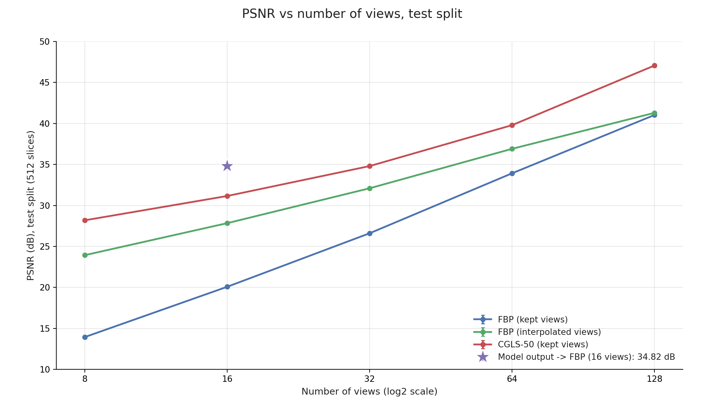
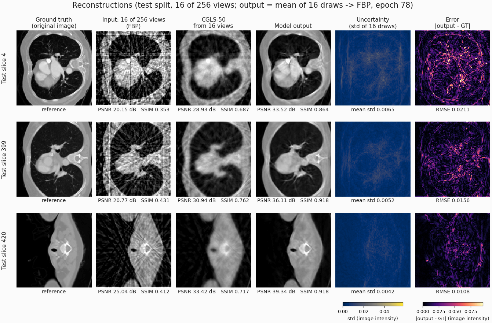

# Sparse-View CT Reconstruction

Tooling and experiments for reconstructing CT images from far fewer X-ray views
than a scanner normally acquires, built during research with the Computational
Imaging Group at UW–Madison.

---

## The problem

A CT scan fires X-rays through the patient from many angles. Each shot measures
a set of line integrals through the body, and the stack of all of them is called
a **sinogram**. A reconstruction algorithm turns that sinogram back into an
image of the slice.

More angles gives a better image. It also means more radiation dose, more time
on the scanner, and more cost. So the question that matters clinically is: **how
few angles can you get away with?**

Filtered backprojection (FBP), the standard reconstruction method, degrades
quickly as views are removed. Here is what that looks like on real patient data
at 181×181 resolution, using FBP over only the views kept (test split, 512
slices; the full curve is plotted under Results):

| Views | Sampling ratio | FBP PSNR |
|------:|---------------:|---------:|
| 256 | full scan | 43.47 dB |
| 128 | 2× | 41.03 dB |
| 64 | 4× | 33.92 dB |
| 32 | 8× | 26.60 dB |
| 16 | 16× | 20.07 dB |
| 8 | 32× | 13.94 dB |

Roughly 6 to 7 dB lost per halving of views below 128 (the first halving, from
256 to 128, costs only 2.4 dB). At 8 views organ
boundaries smear, and anything "recovered" starts to be invention rather than
reconstruction.

The research question is whether a generative model can fill in the angles the
scanner never measured, well enough that a 16-view scan reaches the quality of a
far denser one.

---

## Results

**At 16 views, the model's reconstruction matches CGLS-50 at 32 views: a 2×
reduction in views at equal quality** (34.82 dB against 34.80 dB).

Test split (512 slices, patients not seen in training), 16 of 256 views kept,
mean ± 95% confidence interval:

| Reconstruction | PSNR (dB) | SSIM |
|---|---:|---:|
| FBP, 16 kept views | 20.07 ± 0.17 | 0.422 |
| FBP, interpolated to 256 views | 27.84 ± 0.13 | 0.704 |
| CGLS-50, 16 kept views | 31.15 ± 0.17 | 0.756 |
| **Generative model → FBP** | **34.82 ± 0.17** | **0.880** |
| *Ceiling:* FBP, all 256 views | 43.47 ± 0.16 | 0.984 |
| *Ceiling:* CGLS-50, all 256 views | 54.40 ± 0.25 | 0.997 |

The model row is the mean of 16 sampled completions of the sinogram,
reconstructed with FBP over all 256 views. Paired per slice, it beats CGLS-50
on 100% of test slices, by +3.67 ± 0.09 dB. Against FBP over the kept views,
the same quality would take about 70 views (4.4×).





Caveats: the data are noiseless and simulated with the same projector the
baselines use (which is why the CGLS-50 ceiling is so high); this is one
training run; and the spread of the 16 samples is about 3× smaller than the
actual error, so the uncertainty maps are informative but overconfident.

---

## What is in this repository

The data pipeline, evaluation tooling, and cluster infrastructure I built for
this work:

| File | What it does |
|---|---|
| `dataset/lodopab.py` | LoDoPaB-CT loader. Reads HDF5 slices, downsamples with antialiasing, applies the Radon transform, returns scaled sinograms. Handles patient-disjoint splits and the dataset's zero-padding rows. |
| `scripts/compute_sino_scale.py` | Computes the fixed constant that maps sinograms into [-1, 1]. |
| `scripts/check_fbp_baseline.py` | Measures FBP and CGLS-50 reconstruction quality against view count on a sample of test slices, and draws a comparison figure. |
| `radon_jvp.py` | A Radon transform wrapped in a `torch.autograd.Function` with an explicit forward-mode rule, so it can be differentiated by `torch.func.jvp`. See "Verification" below. |
| `cluster/` | HTCondor submit files and job script for running on CHTC, including checkpoint-and-resume across job restarts. |

**What is deliberately not here.** The generative model itself is not included
here; it is described in the papers listed below. What is here is the CT
problem setup, the measurement pipeline, and the evaluation around it.

---

## The measurement pipeline

LoDoPaB-CT slices are 362×362. The pipeline downsamples them, projects them to
sinograms, and masks out angle columns to simulate a sparse scan.

```
362×362 slice
  → downsample to 181×181 (antialiased)
  → Radon transform, 256 angles over [0°, 180°)
  → 256×256 sinogram  (detector cells × angles)
  → keep every 16th angle column
```

A few choices worth explaining, since each took some working out.

**Why 181×181.** deepinv sets the detector count to `ceil(size·√2)`, and the
network needs a size divisible by 8. 180 gives 255 detector cells, which is not.
181 gives exactly 256, so the sinogram comes out square and the architecture
needs no padding.

**Why one fixed scaling constant.** A sinogram value is a line integral, so it
sits well outside the [-1, 1] range a network expects. It has to be rescaled,
but by a single constant shared across every sample — a per-image scale would
make the forward operator differ per sample, and the inverse problem would stop
being well posed. `compute_sino_scale.py` takes a high percentile across the
training split rather than a maximum, so one unusual slice cannot set the scale
for everything.

**Why `circle=False`.** The projection library offers a mode that crops to the
inscribed circle. Measuring it across the dataset showed it discards between 19%
and 37% of every slice — chest wall, ribs, skin. The images are resized before
projection instead, and the full square is scanned.

**Patient-disjoint splits.** LoDoPaB ships train, validation and test parts whose
patient IDs do not overlap (0–631, 632–691, 692–751). An earlier version of this
pipeline cut a single part per *slice*, which put adjacent slices of the same
patient on both sides of the split and inflated every metric. The loader now
reads one folder per split, so leakage is structurally impossible.

---

## Verification, and what it caught

Measurement code that is subtly wrong still produces plausible numbers, so each
piece of the operator was tested rather than trusted. Five things this found:

**The adjoint was not the adjoint.** The library's default inverse-Radon adjoint
fails the dot-product test `⟨u, Aᵀ A u⟩ / ⟨A u, A u⟩ = 1`, coming out at
0.992–0.993. Running in float64 gave the same answer, so it was not a precision
issue. Computing the adjoint via backpropagation instead gives 1.0000.

**PyTorch cannot forward-differentiate the Radon transform.** The method needs a
Jacobian-vector product through the operator, and `torch.func.jvp` raises
`NotImplementedError` on `grid_sampler_2d`, which the projection is built from.
`radon_jvp.py` wraps the operator in a `torch.autograd.Function` with explicit
`jvp()` and `backward()` methods. Because the Radon transform is linear, both
are exact rather than approximations. Verified by the self-test in
`radon_jvp.py`.

**Zero-filled sinograms are not a fair baseline.** The natural way to measure
a sparse-view baseline is to zero the dropped angle columns and reconstruct with
the full 256-angle operator. That treats the 240 zeroed columns as data: FBP
back-projects them as 240 empty views, and a least-squares solve fits them as if
they were real measurements of zero. With FBP this gives 14.6 dB at 16 views on
the 8 test slices of `check_fbp_baseline.py`, below the 19.7 dB of FBP over the
kept views alone. A fair baseline builds a projection operator over only the
kept angles, and every baseline number here does that.

**`A_dagger` is not filtered backprojection by default.** In deepinv 0.4.2,
`Tomography.A_dagger(y)` with default arguments runs an iterative least-squares
solve (conjugate gradient, up to 50 iterations, tolerance 1e-4), not FBP. FBP
needs `A_dagger(y, fbp=True)`. At 16 views the two are 11 dB apart (20.07 vs
31.15 dB above), so a result reported against "FBP" computed the default way is
really being compared with a much stronger baseline, and vice versa. Both are
shown here: FBP via `fbp=True`, and CGLS-50 via `fbp=False, solver="CG",
max_iter=50, tol=0.0`, a fixed 50 iterations so the answer does not depend on
batch size. `A_dagger` also stores `max_iter` and `tol` on the operator, so
every call should pass all of them.

**Two bugs that only appear on a GPU.** A lazily-imported library inside the
dataset crashed forked DataLoader workers, because importing it triggers a GPU
probe that a forked process cannot do. And projection angles were built on the
CPU and handed to a CUDA operator. Neither reproduces on a laptop.

---

## Running it

Requires `torch`, `deepinv`, `h5py`, `numpy`, `matplotlib`, `pyyaml`, and the
LoDoPaB-CT dataset ([Zenodo](https://doi.org/10.5281/zenodo.3384092), CC BY 4.0).
Only the `ground_truth_*` archives are needed, since sinograms are simulated
here rather than taken from the dataset's own measurements.

Arrange the data as `<root>/{train,val,test}/*.hdf5`, then:

```bash
# find the scaling constant for your geometry
python scripts/compute_sino_scale.py --config configs/ct.yaml

# measure FBP quality against view count
python scripts/check_fbp_baseline.py --config configs/ct.yaml \
    --ratios 1 8 16 32 --out figures/fbp_baseline.png
```

Training runs on HTCondor via the files in `cluster/`. The job script checkpoints
periodically and resumes from the newest checkpoint, so a run that exceeds the
queue's time limit can be resubmitted without losing progress.

---

## Current work: limited-view CT

Sparse-view drops every Nth angle, spread evenly around the patient. **Limited-view**
loses a contiguous wedge instead — everything past 120°, say — because the
scanner physically cannot reach those positions. This happens in real settings
like C-arm imaging and tomosynthesis.

It is a harder problem rather than a variation on the same one. The missing
information is structured instead of scattered, the null space of the operator
is correspondingly larger, and FBP fails in a characteristic directional way
rather than with uniform streaking. Work on this is in progress.

---

## References

- Leuschner et al., "LoDoPaB-CT, a benchmark dataset for low-dose computed tomography reconstruction", Scientific Data 8, 109 (2021)
- Geng et al., "Mean Flows for One-step Generative Modeling"
- Shi, Chandler, Park, Shoushtari, Kamilov, "NullFlow: One-Step Generative Reconstruction", arXiv:2606.22696 (2026)
- Shoushtari, Chandler, Shi, Kamilov, "SNaP: One-Step Posterior Sampling for Noisy Inverse Problems", arXiv:2609.34071 (2026)

Research conducted with the Computational Imaging Group at UW–Madison, advised
by Edward Chandler.
